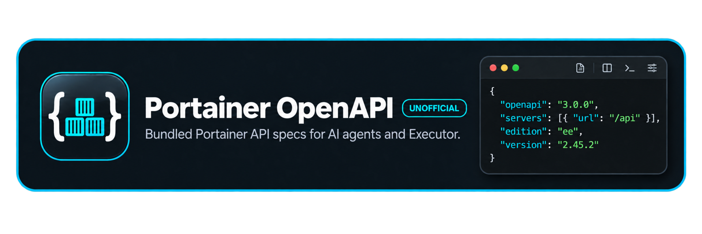

<p align="center"><b><a href="https://kytixo.github.io/portainer-openapi/index.json">Index</a></b> · <a href="https://github.com/KyTiXo/portainer-openapi/actions/workflows/pages.yml">Builds</a> · <a href="https://api-docs.portainer.io">Upstream docs</a></p>

Portainer CE and EE OpenAPI specs, one self-contained JSON file per version, rebuilt daily on GitHub Pages. Upstream splits its spec across files with external `$ref`s, which tools like [Executor](https://github.com/UsefulSoftwareCo/executor) can't load. These are bundled with [`@redocly/cli`](https://github.com/Redocly/redocly-cli) so they work as-is.

## Quick start

```sh
# List every available spec
curl -s https://kytixo.github.io/portainer-openapi/index.json | jq -r '.[]'

# Fetch one: <ce|ee>/<version>.json
curl -sO https://kytixo.github.io/portainer-openapi/ce/2.45.2.json

# Count its endpoints
jq '.paths | length' 2.45.2.json

# Use it: in Executor, Add OpenAPI > URL, paste the spec URL, then set
#   Base URL: https://<your-portainer>/api
#   Auth:     X-API-KEY header with a Portainer access token
```

## Build locally

```sh
./build.sh site   # needs bun, curl, jq. Writes site/<ce|ee>/<version>.json + site/index.json
```

## Unofficial

Not affiliated with, endorsed by, or supported by Portainer. Each spec's `info.description` starts with an "Unofficial bundled copy of …" marker; otherwise the specs are unchanged. They are Portainer's work under its zlib licence. Scripts in this repo are MIT, see [LICENSE](LICENSE).
